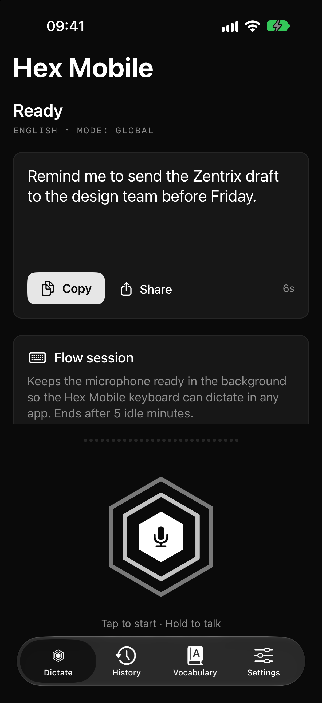
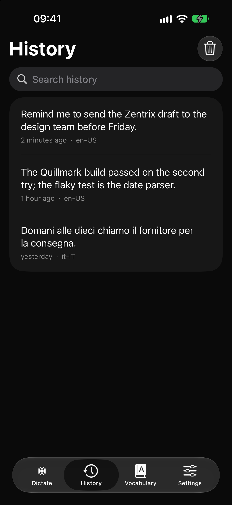
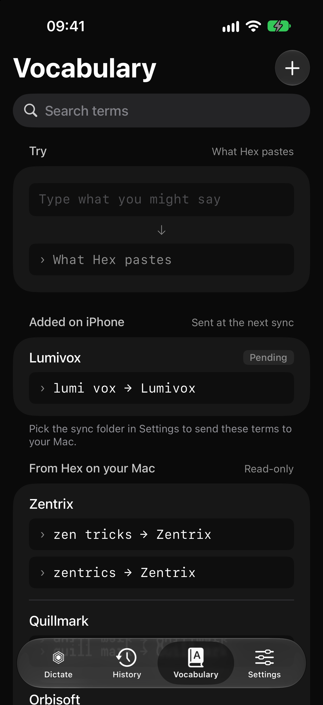
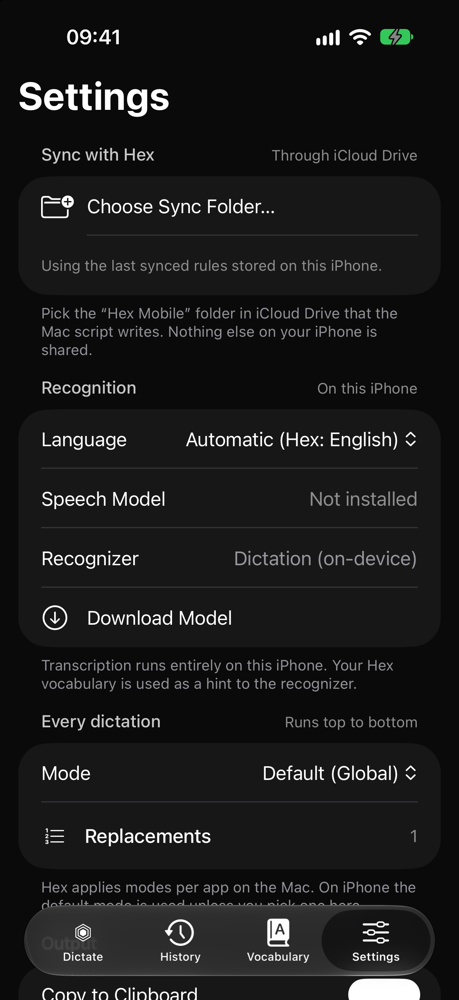

# Hex Mobile Sync

On-device dictation for iPhone that shares its vocabulary and text rules with
[Hex](https://github.com/anomalyco/hex), the dictation app, through Hex on your Mac.

> **Unofficial.** Hex Mobile Sync is a community companion to Hex. It is not
> affiliated with, endorsed by or supported by Hex, its author or Anomaly.
> Please report problems here, not to the Hex project.

**Status: usable, with rough edges.** It works for everyday dictation on the
author's iPhone; the known imperfections are listed in
[Limitations](#limitations). Reports and fixes are welcome.

Hex Mobile Sync is distributed as source only. You build it with Xcode and
install it on your own iPhone. There is no App Store build and no prebuilt
binary.

## Features

- **On-device transcription** with Apple's `SpeechAnalyzer` (iOS 26+). Audio
  never leaves the iPhone. The app and its extensions make no network calls
  and contain no analytics and no cloud model.
- **Accurate second pass.** The live transcript uses the fast recognizer (words
  in about a second). At the stop, the recording goes through the recognizer
  without the fast option, and its text replaces the live one; on a timeout or
  an error the live text stays.
- **Optional Whisper pass (off by default).** Settings > Final Text Engine can
  hand the recording to Whisper (`large-v3` turbo, through WhisperKit) after
  Apple's pass. You copy the 632 MB model to the iPhone yourself; the app never
  downloads it. See [Whisper on the iPhone](#whisper-on-the-iphone-optional).
- **Text cleanup.** "Fix the Text" (Settings, on by default) asks Apple's
  on-device language model (Foundation Models, Apple Intelligence) to add
  punctuation and capitals, drop hesitations and apply spoken corrections
  ("no, anzi…"), without rewording. It never blocks a dictation: when the model
  is not available, is slow, refuses or returns anything that is not a cleanup
  of the text, you get the recognizer's text.
- **Your own spelling.** The terms that bias recognition (the Hex vocabulary
  and the terms you add in the Vocabulary tab) also fix the case of the final
  text: `iphone` becomes `iPhone`. Only case, never letters.
- **Measure recognition (opt-in).** "Keep Audio to Improve Recognition" (off by
  default) keeps the last 20 dictations with their texts on the iPhone, to
  compare recognizers with [`tools/asr-bench`](tools/asr-bench/README.md).
- **Shared vocabulary with Hex.** A small script on your Mac exports Hex's
  vocabulary (terms and their "sounds like" spellings), dictation language and
  dictation modes to an iCloud Drive folder. The iPhone applies the same rewrites
  and also passes up to 100 vocabulary terms to the recognizer as context.
  With no folder picked, or a folder that gave no terms, the Dictate screen
  (under the language line) and Settings > Sync say so in one line: with no
  terms neither Apple's recognizer nor Whisper has a hint for your names.
- **Two-way vocabulary.** Terms you add on the iPhone are queued in the same
  folder and added to Hex the next time the Mac script runs while Hex is open.
- **Hex text rules.** Mode replacements and the built-in transformations
  `lowercase`, `no-trailing-punctuation` and `spongebob-case`. The default mode
  applies; you can pick another mode by hand in Settings.
- **Many ways to start:** a big record button in the app (tap to toggle,
  long-press for push-to-talk), the Action Button, a Control Center control,
  Shortcuts and Siri, and a custom keyboard that dictates into any app.
- **Live Activity** on the Lock Screen and in the Dynamic Island while
  recording, with a stop button.
- **Clipboard and history.** The final text is copied to the clipboard (can be
  turned off) and kept in an on-device history with retention of a day, a week
  (default), a month or forever. History can optionally be shared with the Mac.
- **Works with a free Apple ID.** The project uses no capability a free
  Personal Team cannot sign: no App Groups, no iCloud entitlement, no push.
- English and Italian user interface.

## Screenshots

Captured on the iOS Simulator with synthetic demo content (Debug builds only:
launch with `-HexMobileDemo YES -HexMobileTab <tab>`). The keyboard and the
Live Activity still need captures from a real device.

Other Debug-only launch options: `-HexMobileAutoStart YES` starts one dictation
when the app becomes active and stops it after `-HexMobileAutoStartSeconds N`
seconds (default 6); the outcome goes to the diagnostics log as `autostart`
lines, without text. With `-HexMobileAutoInstall YES` it also downloads the
speech model when the start fails for a missing one (what the Download Model
button does). `-HexMobileAutoStartIntent YES` runs the Action Button path
(`IntentBridge.toggleDictation`, a second time after the listening seconds)
instead of a plain start; `-HexMobileAutoHandoff hold|press|adopt` opens an
Action Button session holding a synthetic text, to try the wait for the keyboard
(`printf 'HEXMOBILE-PULL 1\n' | nc 127.0.0.1 47391` plays the keyboard);
`-HexMobileAutoFlow YES` opens a flow session for the
listening seconds instead and logs the audio and memory fields;
`-HexMobileFakeEngine YES` swaps the speech recognizer for one that hears
nothing and "transcribes" a fixed sentence, so the simulator (which has no
speech model) can run a whole dictation; `-HexMobileFakeFinalPass
ok|messy|slow|fail|short|empty` makes the accurate pass a fake one (`messy`
returns an unpunctuated sentence with a hesitation and a spoken correction, to
try the cleanup with the real language model) and `-HexMobileCleanupTimeoutMs N`
gives the cleanup N ms; `-HexMobileFakeClip <absolute path>` makes the fake engine
record that audio file (16 kHz mono 16-bit, as the analyzer writes it) instead of a
second of silence, and with `-settings.finalTextEngine whisper` and
`-HexMobileWhisperDeadline N` the real Whisper model reads it on the simulator
(`make push-whisper-model-sim SIM=<udid>` puts the model in its container; the
simulator runs it on the CPU, about five times slower than real time, so the
deadline is raised to N seconds; the first launch after `simctl install` ignores
launch options); with the fake engine, `xcrun simctl spawn <udid>
notifyutil -p io.github.hexmobile.toggle|cancel` plays the keyboard's keys and
the `nc` line above reads what it would take;
`-HexMobileAutoOpenURL <url>` hands a `hexmobile://` link to the app as if the
system had opened it (`xcrun simctl openurl` stops at the system's «open in Hex
Mobile?» alert, which only a tap answers, and a headless simulator has none);
`-HexMobileSlowFlowStart N` makes a flow session start wait N seconds before its
first audio attempt, and `-HexMobileAutoRaceMs M` (with `-HexMobileAutoStartIntent`)
presses the Action Button intent twice M ms apart, to try the cancel of a start
in progress;
`-HexMobileSimulateWhat N` makes the first N `engine.start` calls fail with a
simulated `'what'`, to run the retry ladder of a flow session start (one
failure reaches the session reset, two the `.record` category; the real error
never happens on the simulator);
`-HexMobileKeyboardProbe YES` gives a text field focus at launch and asks it for
the Hex Mobile keyboard (the keyboard must be in Settings > Keyboards of the
simulator, as it is once added there), so the keyboard extension runs on the
simulator and writes its log; `-HexMobileKeyboardProbeResign N` makes the field
give the keyboard up after N seconds (the orderly end of a keyboard session);
`-HexMobileKeyboardProbeFlick N` (with `-HexMobileKeyboardProbeFlickMs M`, default
40) makes it ask for the keyboard and give it up again N times, M ms apart: with a
small M iOS loads keyboard controllers it never shows (`keyboard load` with no
`appear`), as on the phone;
`-HexMobileAutoDurationChange YES` (with `-HexMobileAutoFlow`) sets the running
session's idle time to Never, 15 and 5 minutes, 3 s apart, as the picker in
Settings does (to start a run with a stored value, write it into the app's own
container: `xcrun simctl spawn <udid> defaults write
"$(xcrun simctl get_app_container <udid> <bundle id> data)/Library/Preferences/<bundle id>"
settings.flowSessionMinutes -int 0`; a plain `defaults write <bundle id>` goes to
another file and the app never reads it);
`-HexMobileAutoOSLog YES` opens one and writes the audio OSLog dump described
under [Diagnostics](#diagnostics).
`-HexMobileScroll bottom` scrolls the Dictate screen to its end
after three seconds. To pick a language for a run, add
`-settings.languageIdentifier <bcp47>`; it is not saved.

| Dictate | History | Vocabulary | Settings |
|---|---|---|---|
|  |  |  |  |

## How it works

```
Mac                                              iPhone
Hex.app ── hex CLI (--json) ──► mac/hex-mobile-sync.sh ──► iCloud Drive/Hex Mobile/
                                  ▲  (launchd: file watch + every 15 min)   hex-mobile-sync.json
                                  └── applies pending-vocabulary.json ◄──── pending-vocabulary.json
                                                                            iphone-history.jsonl (optional)

iPhone: Hex Mobile app ── SpeechAnalyzer (on device) ── accurate pass ── cleanup (on device) ── text pipeline ──► clipboard + history
          ▲   │
          │   └── Darwin notifications + pasteboard ──► Hex Mobile keyboard (any app)
          └── Action Button / Control Center / Shortcuts (App Intents, Live Activity)
```

- The Mac script reads Hex **only through the Hex CLI**. When Hex is not
  running it falls back to reading Hex's `settings.json` read-only. It never
  writes Hex's files. Hex's AI post-processing settings (prompt and model) are
  never exported.
- The iPhone app gets access to the `Hex Mobile` folder once, when you pick it
  in the Files picker. It keeps a security-scoped bookmark and reads and writes
  the folder with file coordination, so it needs no iCloud entitlement.
- After the stop the text goes through: the accurate pass over the recording
  (Apple's, then Whisper's when you chose it), the language-model cleanup, the
  spelling of your terms, then the Hex steps:
  vocabulary rewrite (each "sounds like" spelling becomes its term), mode
  replacements, then transformations. Matching ignores case but not accents,
  works on whole words only, and prefers the longest phrase. Every step before
  the Hex ones falls back to the text it received.

Details: [docs/ARCHITECTURE.md](docs/ARCHITECTURE.md). Full spec:
[docs/PLAN.md](docs/PLAN.md).

## Requirements

- An iPhone with **iOS 26 or later**. Transcription relies on Apple's
  `SpeechAnalyzer`, which does not exist on earlier versions. The speech model
  for your language is downloaded by iOS the first time (the app shows a
  Download Model button).
- Optional, for "Fix the Text": an iPhone that supports Apple Intelligence, with
  it turned on and the language model downloaded. Without it the app dictates as
  before and Settings says why the cleanup is off.
- A Mac with **Xcode 27.2 or later** (iOS 27.2 SDK) to build, plus
  [XcodeGen](https://github.com/yonaskolb/XcodeGen) (`brew install xcodegen`).
- Network on the Mac for the first build: Xcode fetches one Swift package,
  [WhisperKit](https://github.com/argmaxinc/argmax-oss-swift), pinned to 1.1.1.
  The app itself makes no network requests when it runs.
- Optional, for Whisper: about 630 MB free on the iPhone and the model on the Mac
  (see [Whisper on the iPhone](#whisper-on-the-iphone-optional)).
- An Apple ID. A free one is enough.
- For sync: Hex installed on the Mac, iCloud Drive turned on on both the Mac and
  the iPhone with the same Apple ID, and `jq` (shipped with recent macOS as
  `/usr/bin/jq`, otherwise `brew install jq`).

## Install on your iPhone with a free Apple ID

1. **Get the source.**
   ```sh
   git clone <this repository> hex-mobile-sync
   cd hex-mobile-sync
   ```
2. **Add your Apple ID to Xcode.** Xcode > Settings > Accounts > `+` > Apple ID.
   Xcode creates a "Personal Team" for it.
3. **Set your team and a unique bundle ID prefix.**
   ```sh
   cp Config/Local.xcconfig.example Config/Local.xcconfig
   ```
   Edit `Config/Local.xcconfig`:
   - `DEVELOPMENT_TEAM`: your team ID. Find it in Xcode > Settings > Accounts >
     your Apple ID, or in a target's Signing & Capabilities tab after you select
     your team once.
   - `BUNDLE_ID_PREFIX`: a reverse-DNS prefix of your own, for example
     `com.example.yourname`. Bundle identifiers must be unique per Apple ID, so
     the default `io.github.hexmobile` will usually not sign with a Personal
     Team.

   `Config/Local.xcconfig` is gitignored.
4. **Generate the Xcode project.** The `.xcodeproj` is not committed.
   ```sh
   make project
   ```
5. **Turn on Developer Mode on the iPhone.** Connect the iPhone to the Mac by
   cable and trust the computer. On the iPhone open Settings > Privacy &
   Security > Developer Mode, turn it on and restart when asked. (The option
   appears after the iPhone has been connected to Xcode at least once.)
6. **Build and install.** Either:
   - open `HexMobile.xcodeproj`, choose the `HexMobile` scheme and your iPhone
     as destination, and press Run; or
   - from the terminal:
     ```sh
     xcrun devicectl list devices          # find your iPhone's identifier
     make install-device DEVICE=<identifier>
     ```
7. **Trust your developer certificate.** The first launch is blocked until you
   open Settings > General > VPN & Device Management on the iPhone, select your
   Apple ID under Developer App and tap Trust.
8. **Open Hex Mobile**, allow microphone and speech recognition, and download
   the speech model for your language when the app asks.

### The 7-day limit

Apps signed by a free Personal Team expire **7 days** after signing. After that
the app no longer opens. To renew, connect the iPhone and build and install
again (step 6). Reinstalling over the same bundle identifier normally keeps app
data (history, settings, sync folder choice); this has not yet been confirmed
on a device for this app.

Apple also limits how many apps and app identifiers a free team can register
in a given period. Hex Mobile Sync registers three identifiers (app, widgets,
keyboard). If Xcode reports a limit, check Apple's current rules for free
accounts.

### With a paid Apple Developer account

Everything works the same way. The only difference is that the provisioning
profile lasts much longer (up to a year), so you re-sign far less often. You can
also keep the default bundle ID prefix if you own a matching identifier. No
extra capability is used even with a paid account.

## Mac sync setup

The Mac side is a shell script run by a per-user launchd agent. It needs Hex
(with its `hex` CLI at `/Applications/Hex.app/Contents/MacOS/hex`) and `jq`.

1. Make sure iCloud Drive is on for the Mac.
2. Install the agent:
   ```sh
   mac/install.sh
   ```
   It copies the script to `~/Library/Application Support/hex-mobile-sync/`,
   writes `~/Library/LaunchAgents/io.github.hexmobile.sync.plist` and loads it.
   The agent runs at login, every 15 minutes, and whenever Hex's settings or
   the pending vocabulary file change. It creates the folder
   `iCloud Drive/Hex Mobile` if it is missing.

   Useful options: `--print` shows the plist without installing anything;
   `--sync-dir DIR` uses another folder; `--label LABEL` changes the agent
   label. Run once by hand to check:
   ```sh
   mac/hex-mobile-sync.sh --dry-run --verbose
   ```
3. On the iPhone, open Hex Mobile > Settings > Sync with Hex > Choose Sync
   Folder… and pick **iCloud Drive > Hex Mobile**. Tap Sync Now.

To remove the agent: `mac/uninstall.sh` (add `--purge` to also delete the
installed script, its state and the log). The sync folder is never deleted.

Logs go to `~/Library/Logs/hex-mobile-sync.log`. Flags, environment variables,
exit codes and error handling are documented in [mac/README.md](mac/README.md).

## Keyboard setup

The Hex Mobile keyboard lets you dictate into any app, Wispr Flow style.

1. On the iPhone open Settings > General > Keyboard > Keyboards > Add New
   Keyboard and choose **Hex Mobile**.
2. Tap Hex Mobile in the list and turn on **Allow Full Access**.
3. In any app, switch to the Hex Mobile keyboard with the globe key and tap the
   microphone. With no flow session running, one tap opens Hex Mobile, which
   starts a **flow session** and dictation at once and shows a screen saying
   so. Go back to the app you were in: iOS shows a button at the top left of
   the screen (the previous app's name), or swipe right along the bottom edge.
   The dictation keeps running whether or not you go back within a few
   seconds; the app cannot switch back by itself, iOS gives it no way to.
4. Back in the text field, the keyboard shows ✕ and ✓ while it records, and the
   blob in the microphone key moves with your voice (with Reduce Motion on it
   stays still and only grows and brightens with the level): ✓ (or a
   tap on the microphone key) stops, transcribes and inserts the text at the
   cursor; ✕ drops the dictation and inserts nothing. When a dictation cannot
   start or fails, the keyboard's top bar shows why, with Close and Retry (Retry
   does what the microphone key did). You can also start a flow session by hand (Dictate
   tab, Settings, or the "Start Flow Session" shortcut); while it runs, the
   microphone key dictates without leaving the app. It ends by itself after the
   idle time set in Settings > Flow Session > End After Idle: 5 minutes (the
   default), 15 minutes, 1 hour or Never. With Never the session stays on, the
   microphone with it, until you end it, and the Dynamic Island and the Lock
   Screen say so (an infinity sign and "Stays on until you end it"). An earlier
   setting of 1 to 30 minutes reads as the next choice up (10 becomes 15). The
   Action Button's session is the exception: it ends after its dictation
   whatever you chose.

**Why Full Access?** A keyboard extension cannot record audio and, without an
App Group, cannot share storage with its app. So the app does the recording and
transcription, then puts the result on the pasteboard; the keyboard needs Full
Access to read the pasteboard and insert the text. The keyboard has no network
code and only reads the dictation the app placed there (a dedicated pasteboard
type, inserted once per dictation). It does not log or store what you type.
Because the pasteboard is the channel, a dictation started from the keyboard
is placed on the clipboard even when Copy to Clipboard is off; that copy stays
on the iPhone (no Universal Clipboard) and expires after two minutes. The
keyboard inserts a result automatically only when it asked for the stop
itself; a dictation stopped elsewhere (Live Activity, Action Button) is offered
with the Insert key instead.

If no flow session is running, the microphone key opens the app on
`hexmobile://dictate?source=keyboard` (see above). iOS does not always let
keyboards open apps; if nothing happens, the keyboard says so: open Hex Mobile,
start the session there and come back.

## Action Button and Control Center

The control **Hex Dictation** and the shortcut **Dictate with Hex Mobile** both
run the same action: the first press starts recording (a Live Activity appears),
the second stops, transcribes on the iPhone, copies the text to the clipboard
and returns it as the shortcut's output. If the first press had to open a
flow session, the dictation closes it. With no text to hand over (the second
press heard nothing, the dictation failed, or the Live Activity's stop button
was used before any text), the microphone and the Live Activity end at once.
With a text finished in the background, the session stays up until the
Hex Mobile keyboard has taken the text, and for one minute at most: iOS keeps
the app alive only while the microphone runs, and the keyboard fetches the text
from the app. While it waits, the Live Activity (Dynamic Island and Lock Screen)
shows the start of the text and asks you to open the Hex Mobile keyboard to
insert it; iOS drops the clipboard copy of a dictation finished in the
background, so the text is not on the clipboard until then. A new press inside
that minute dictates in the same session. A
flow session that was already running (from the app, the keyboard or the Start
Flow Session shortcut) is left as it was, and starting a flow session
explicitly while the Action Button's one is up keeps it for the idle time.
If iOS refuses the microphone for about 3 seconds after a press from the
background, the shortcut ends with a message asking you to press the Action
Button again; a second press has worked every time so far.

- **Action Button** (iPhone 15 Pro and later): Settings > Action Button > swipe
  to Controls > Choose a Control > Hex Dictation. Or choose Shortcut and pick
  Dictate with Hex Mobile.
- **Control Center:** open Control Center, tap `+` in the top-left corner, Add
  a Control, search for Hex Dictation.
- **Shortcuts and Siri:** "Dictate with Hex Mobile" and "Start a Hex Mobile flow
  session" are available as App Shortcuts.

The control is a button rather than an on/off toggle: without an App Group the
widget extension cannot know whether the app is recording, so it could not show
a reliable state. The Live Activity shows the state instead.

The same steps are in the app under Settings > Setup Guides.

## Whisper on the iPhone (optional)

The accurate pass after the stop can run a second engine, Whisper
(`large-v3` turbo, 632 MB, through [WhisperKit](https://github.com/argmaxinc/argmax-oss-swift),
MIT). It reads the same recording after the Apple pass and, when it finishes
inside the time left, its text replaces Apple's, with your vocabulary terms
as the prompt. The default stays Apple. Settings > **Final Text Engine** offers
Whisper only when the model is installed, and says why when it is not.

**The app never downloads the model.** It looks for it in its own container,
`Library/Application Support/whisper/`, and you copy it there from the Mac. The
folder is excluded from backups. WhisperKit contains code that downloads models
and tokenizers from Hugging Face; the app never calls it (`download: false`)
and refuses to start Whisper unless the model and the tokenizer files are on
disk, because the library would otherwise fetch a missing tokenizer by itself.

1. Put the model and the tokenizer on the Mac, in `build/whisper-models`: the
   folders `models/argmaxinc/whisperkit-coreml/openai_whisper-large-v3-v20240930_turbo_632MB`
   and `tokenizers/models/openai/whisper-large-v3` (`tokenizer.json`,
   `tokenizer_config.json`, `config.json`). One way is `whisperkit-cli transcribe
   --model large-v3-v20240930_turbo_632MB --download-model-path build/whisper-models
   --download-tokenizer-path build/whisper-models/tokenizers --audio-path <any short clip>`
   (da verificare: the exact `--model` spelling was not re-run when this was written).
   Only the `large-v3` family is accepted.
2. Copy them to the iPhone (the app installed, the iPhone unlocked):

   ```sh
   make push-whisper-model DEVICE=<udid>        # xcrun devicectl list devices
   ```

   It runs `xcrun devicectl device copy to --domain-type appDataContainer
   --domain-identifier <BUNDLE_ID_PREFIX>.HexMobile` twice (the model folder
   to `Library/Application Support/whisper/<model folder>`, the tokenizer folder
   to `Library/Application Support/whisper/tokenizers/models/openai/whisper-large-v3`)
   and lists the result. Copying a folder with `devicectl` was not proven on a
   device when this was written, and where a copied folder lands (as the
   destination, or inside it) is not documented, so the app accepts the model
   up to two folders below `whisper/` and the tokenizer up to five. To see
   where things landed: `xcrun devicectl device info files --device <udid>
   --domain-type appDataContainer --domain-identifier <BUNDLE_ID_PREFIX>.HexMobile
   --subdirectory "Library/Application Support/whisper"` (and one level deeper).
   For a simulator, `make push-whisper-model-sim SIM=<udid>` copies into the app's
   container folder (`devicectl` cannot reach simulators).
3. Open Settings > Final Text Engine and tap **Prepare Whisper**, with the app
   open on screen. The first load after a copy, or after an iOS update, makes
   Core ML compile the model for the Neural Engine: **about 12 minutes** on an
   iPhone 16 Pro (746.58 s, the phone log of 2 Nov 2026; later loads 2.9 to
   3.6 s). Until it ends, Apple's text is used. Settings says so: under the
   button, while Whisper has never been prepared on this model and this iOS
   version ("No record of Whisper loading on this iPhone yet, or iOS was updated since … about 12 minutes …
   keep Hex Mobile open on screen until the status says Ready"), and under the
   progress indicator while it compiles. "Prepared" is a marker written after a
   load on the Neural Engine that succeeded (not the CPU-only load that follows a Core ML
   error, which compiles nothing for it), keyed by model name and iOS version
   (`WhisperModel.preparedFor`); it says that load worked once, not that Core
   ML still holds the compiled model (ipotesi: the system may drop its cache).
   A phone that compiled the model before this marker existed shows the note
   once, until its next successful load (3 s). The app does not keep the screen awake and does not ask for confirmation
   before the load: a choice made in place of the author, to leave the button as
   it was.

How it runs:

- **Order and time.** Apple's pass runs first. Whisper then starts only if its
  estimated time **and** the estimated time of the cleanup both fit in what is
  left of the 8 s after the stop. Whisper must be done at `8 s - cleanup reserve`
  **after the stop** (an absolute time, not a duration) and has what is left of
  that: `available = 8 s - reserve - time since the stop`. The reserve is 1.3 x
  (0.25 s + 3.9 ms per character of Apple's text), at least 1 s, **plus 0.4 s** (and 0.45 s more, below):
  a Core ML prediction cannot be interrupted, so when Whisper reaches its deadline
  the model goes on for a moment on the Neural Engine, the cleanup starts on the
  same unit, and a short text used to reserve just the 1 s under which the
  cleanup is not started (0.4 is a choice in place of the author, between the 0.3
  and 0.5 asked for; the contention is not measured on a phone). The reserve also
  holds the 0.45 s the cleanup itself keeps before the 8 s (a choice in place of
  the author, between the 0.4 and 0.5 asked for; see the next item). So the cleanup
  always finds at least 1.4 s. When there is no cleanup (setting off, model not
  available) the reserve is zero. After the plan the app awaits the Live Activity
  update, which takes time of its own: the plan is **asked again with the clock
  as it is then**, and the deadline handed to Whisper is the same absolute time
  minus that wait (before, the wait came out of the cleanup's reserve and a
  short text lost its cleanup). `at=` in the log line is that clock. Whisper's
  estimate is 1.15 x (0.1 s + 0.4 s per
  piece + 15 ms per decoder step), the steps being the prompt and control tokens
  of every piece plus 6 tokens per second of audio. An estimate that does not
  fit is not started (`reason=budget`, log `whisper plan skip estimate=…
  available=…`, with `after-wait` when the wait took the room). There is no
  tighter ceiling on Whisper's deadline (such as 1.5 x the estimate): the
  estimate comes from four runs without pieces, and one is left to the
  measurements of the phone. **This is a choice made by the coordinator in place
  of the author** (2 Nov 2026), who asked for the text formatted and then to go on
  without questions: on a long dictation Apple's text goes to the cleanup instead
  of Whisper's, because a punctuated and capitalized text is what the author asked for and
  Whisper's gain does not pay for losing it. To flip it, give the reserve a zero
  in `FinalPassPolicy.whisperPlan`. Where it lands (elapsed 0.5 to 2 s after the
  stop, 18 characters per second of speech; a replica of the formulas, not a phone
  run): **with the vocabulary prompt** Whisper runs up to about 14.7 s, one piece
  (15.0 s for a 98-token prompt; 12.5 s when Apple's pass ended 2 s after the
  stop); from 15 s the recording is two pieces, the
  estimate jumps to about 6.2 s and it is skipped. **Without terms** (no prompt) it
  runs up to 21 to 27 s (the end-to-end margin took about 2.5 s off the 24 to 29
  of batch 10). The constants are fitted on four phone
  runs; the piece count and the cost of a piece come from the Mac, the phone has
  not run pieces yet (ipotesi: slower than the estimate for fast speakers). `whisper plan run estimate=…`, `whisper
  timings` and `rtf=` in `diagnostics.log` are what replaces them.
- **Cleanup time grows with the text, and it does not start if it would overrun.**
  The cleanup model writes the text again: 0.25 s + 3.9 ms per character on the
  phone (86 characters in 0.55 to 0.63 s, 435 in 1.65 s, 760 in 3.17 s, 1127 in
  4.19 s). The text must be there 8 s after the stop at the latest, and 0.45 s of
  that are kept for what follows the cleanup (guard, spelling, history, insertion;
  a choice in place of the author, between the 0.4 and 0.5 asked for). So the
  cleanup has an absolute deadline, 7.55 s after the stop, and starts only if its
  estimate fits what is left until then (and that is at least 1 s). If not, the
  raw text arrives at once and the log says `cleanup dt=0.00 outcome=fallback
  reason=budget in=N out=0 estimate=… available=…`. On 2 Nov 2026 1890
  characters started 1.3 s after the stop, were cut at 6.6 s and returned nothing;
  now they are skipped. The longest text that still gets the cleanup is
  (7.55 s - time of Apple's pass - 0.25 s) / 3.9 ms: about 1,740 characters after
  a 0.5 s pass, about 1,540 after the 1.3 s one of that long dictation. Running
  the cleanup during the recording is a later batch.
- **Guard.** Whisper's text is used only if it has at least half of the words of
  the text in hand and refuses no gap in it; otherwise that text stays
  (`reason=short`, `empty`, `gap`, `timeout`, `error`). The text in hand is
  Apple's pass, **or the live transcript when the Apple pass fell back**
  (`apple.text` is the live text then; the log calls it `live=` and
  `live_words=`, not `apple`). The length rule alone cannot see a lost
  sentence: on 2 Nov 2026 Whisper's 728 characters against Apple's 760 had six
  words missing. The gap check aligns the two texts word by word (lowercase, no
  punctuation, accents count, as in the WER of `asr-bench`) and compares, in each
  stretch between matched words, the words of the text in hand with no counterpart
  (`unmatched`) with the words Whisper wrote there (`written`). A name spelled another
  way or a number written out ("3" for "tre") is a substitution: one for one, no
  cost. A gap is refused when `unmatched - written` is at least **five**, or when
  `unmatched` is at least five and Whisper wrote at least **three** fewer words
  (half the run, rounded up). The second rule exists because Whisper can fill the
  silence at the end of a piece with words that were never said, and nine lost
  words behind five invented ones are a net of four. Two stretches with one
  matched word of one or two letters between them (`il`, `di`, `e`) count as one,
  because the aligner takes any such word inside a lost stretch as an anchor and
  would split five lost words in two and three; two matched words in a row, or
  one of three letters, keep them apart. Five covers the two losses seen (6 and 25
  words); on 13 complete synthetic texts the longest run was 1. The cover
  rule (3) and the merge are not measured on a phone, ipotesi: a real text with
  five unmatched words and two written, none of them a loss, is refused. It is
  conservative: if Apple itself holds five words that Whisper rightly left out,
  Apple's text stays. `guard gap=N at=i … unmatched=R written=C` in the log gives
  the net, the index of the first unmatched word and the two counts, so the line
  says which rule fired. Two texts too long to align (about 1000 words each, not a
  dictation of this app) are not judged and Whisper's text is used: the log says
  `guard skipped reason=too-long cells=…`.
- **Loading.** The model loads when a flow session opens (the Action Button or
  the keyboard) and stays in memory until the session ends, or until a memory
  warning. A dictation outside a flow session (the button in the app) loads it
  alongside the recording and releases it at the end, so it only helps when the
  load finishes before you stop; otherwise Apple's text is used
  (`reason=not-ready`). In practice Whisper pays off inside flow sessions, and
  after Settings > Prepare Whisper has made Core ML compile the model once.
  A model that is loading when the session ends is released as soon as the load
  ends.
- **Compute units.** The mel spectrogram runs on the CPU; the encoder and the
  decoder on the CPU and Neural Engine. Whether the Neural Engine is allowed in
  the background (the Action Button) was not verified; after a Core ML error in
  a run, the next load uses the CPU only. The simulator always uses the CPU.
- **Prompt.** At most 100 tokens of terms (WhisperKit keeps only the last 111 of a
  longer prompt, silently dropping the first terms); `whisper prompt terms=N/M
  tokens=K` says how many fit. With no terms there is no prompt, and the
  Dictate and Settings notice above says it.
- **Long dictations are read in pieces.** The Whisper decoder has a context of 224
  tokens, shared by the prompt, five control tokens and the text it writes. With
  the 100-token prompt that is room for about 15 s of speech; in a 30 s window
  WhisperKit ran out of room and dropped the rest of the window without a word
  (the phone of 2 Nov 2026 lost one to two sentences of a 42 s dictation at second
  30; the same on the Mac with the same options: 23 % of the words missing on
  three 42 to 104 s clips). Now a recording longer than the room is cut where the
  speaker pauses (the quietest 240 ms between half and the whole of the allowed
  length) and read piece by piece in one call: `max = (224 - 5 - 1 - prompt tokens)
  / 8 tokens per second`, 15.0 s for a 98-token prompt, between 8 and 28 s. A
  recording shorter than that is read as before. In continuous speech with no
  pause a cut can fall inside a word (the text guard below sees only five
  missing words in a row, not one). Each piece starts as a new sentence
  for the model, so a capital followed a comma («registrazioni, Perché»). The
  pieces are now joined by `WhisperClips.join`: the first letter of a piece that
  follows a comma, a semicolon, a colon or a word with no punctuation is
  lowercased; after `.`, `!`, `?` or `…` the capital stays, and so do words with
  two or more capitals (`IBAN`, `LoRA`) and a piece that opens with a quote or a
  bracket. The user's terms get their spelling back from the respell that follows.
  **A proper name that is not one of the terms and opens a piece after a comma is
  lowercased too** («…, bergamo»): a name cannot be told from a sentence start
  without a dictionary, and the Apple join (`appendingSegment`) still leaves the
  capital alone for that reason. The cleanup, when it runs, may give it back
  (da verificare). The join applies only when the library wrote one segment per
  window; otherwise its text is kept. In every case the text starts with a
  capital (`WhisperClips.capitalizingFirstLetter`): with the vocabulary prompt,
  which ends with a comma, Whisper began a sentence in lowercase («sta andando…»,
  2 Nov 2026). A first word with a capital inside (`iPhone`), a digit, a quote or
  a bracket stays as it is.
  The price is one more encoder pass and one more prompt per piece (about 0.4 s and
  1.5 s): the same 42 s clip takes 9.3 s on the Mac instead of 5.5 s and the
  text is whole.
- **Reproducing it on the Mac.** `tools/whisper-bench` runs the very same recipe
  (`Packages/HexMobileWhisper`, the one place that builds the decoding options)
  and prints the text; `asr-bench --external` scores it. `--no-pieces` brings back
  the cut text. See `tools/whisper-bench/README.md`.

Log lines (`diagnostics.log`, never any dictated text):

| Line | Meaning |
| --- | --- |
| `whisper load begin reason=flow-session\|dictation\|dictation-in-session\|setting-changed\|prepare model=…` | a load started |
| `whisper load dt=… units=mel:…/enc:…/dec:… footprint=…MB peak=…MB` | the model is in memory; `units` are the compute units actually requested; `peak` is the most the process has used so far |
| `whisper load failed dt=… reason=…` | the load failed (the reason is a domain/code or `no-tokenizer`) |
| `whisper plan run estimate=… deadline=… at=…s rec=…s prompt=T cleanup=N` / `whisper plan skip estimate=… available=… [after-wait] …` / `whisper plan not ready state=…` | the decision after the stop; `at` is the time since the stop when the plan was decided again after the Live Activity update (`deadline` is counted from it), `prompt` is the prompt tokens the plan counted: the real count of the terms when the model is ready (the tokenizer, bounded to 0.3 s), else the cap of 100, written `prompt=100(cap)`, `cleanup` the characters the cleanup reserve was computed on (`-`: no cleanup follows) |
| `whisper prompt terms=N/M tokens=K` | how many vocabulary terms fit the prompt |
| `whisper pieces n=4 max=15.0s prompt=98 rec=42.4s` | the recording is read in `n` pieces of at most `max` seconds (`n=1`: as it is) |
| `whisper timings windows=W steps=S enc=…s dec=…s pipeline=…s` | what the library measured: windows decoded, decoder steps (prompt included, once per window), seconds in the encoder, in the decoding loop (encoder included) and in all |
| `whisper join pieces=4 lowercased=2` | the pieces were put together; `lowercased` is how many started with a capital that was lowered because the sentence went on (not logged when the library's text is kept) |
| `whisper run footprint=…MB peak=…MB` | memory after the run |
| `guard gap=N at=i engine=whisper apple_words=A final_words=W unmatched=R written=C` | Whisper's text was refused (`reason=gap`): in a stretch of the text in hand (`apple_words`, or `live_words` when Apple's pass fell back), starting at word `i`, `R` words have no counterpart in Whisper's and Whisper wrote `C` there; `N = R - C` |
| `guard skipped reason=too-long cells=N …` | the guard was asked for and the texts were too long to align: Whisper's text was used without the check |
| `final pass dt=… outcome=ok\|fallback engine=whisper reason=… apple=N final=M rtf=…` | the result; `apple` and `final` are character counts, `rtf` is run time over recording time (only when the run finished) |
| `whisper release reason=…` / `whisper unloaded footprint=…MB` | the model was given back (the second line comes when it is really gone, later if a load or run was in progress) |
| `whisper unloaded +10s footprint=…MB peak=…MB state=…` | the same measure ten seconds after the unload: Core ML gives memory back late, if at all, so the first figure says little. `state` is the holder's state at that moment; anything but `unloaded` (a new load began) means the footprint includes it |
| `whisper memory warning state=…` | iOS asked for memory; a loaded or loading model is released |
| `whisper compute fallback next=cpuOnly after=…` | a Core ML error; the next load uses the CPU only |

With "Keep Audio" on, the clip JSON records `final_engine` (whose text went to
the cleanup: `whisper`, the Apple engine or `live`) and, when Whisper was chosen,
`whisper_text`, `whisper_outcome` and `whisper_seconds` next to Apple's
`final_pass_text`; `tools/asr-bench` shows them as `phone-whisper`. The schema
version is still 1: the fields are optional and older clips decode as before.

What was measured, on the simulator only (1 Nov 2026; CPU, Core ML cannot use the
Neural Engine there; synthetic voice; three runs with 4.2 to 5.1 s clips): the
first load after each install took 22 to 34 s (four loads; Core ML compiles the
model again), a later load 0.9 and 1.8 s (two loads); reading a clip took 3.2 to
5.2 times its length (`rtf`), with the first prediction included; the process
footprint (`phys_footprint`) peaked at 225 to 236 MB while the simulator
process's resident size (`ps rss`) reached 2.7 to 2.9 GB. The two do not agree,
and which one predicts the iPhone's memory kill is not known. None of this says
what the iPhone does: the Neural Engine, the memory limit of an app in the
background and the real `rtf` are measured only by a run on the device (the
first things to read there are `peak=` in `whisper load` and `whisper run` and
`available=` in `whisper plan run`). On those three clips Whisper wrote one
text exactly as in the reference and two with wrong words (`Rebiti` for `redditi`; `Vercell` and
`Senity` for the names Vercel and Sanity), which proves nothing about quality
either way.

## Diagnostics

When something fails on the iPhone, two files in the app's Application Support
folder say what happened. Neither holds dictated text, both are excluded from
backups, and nothing leaves the iPhone unless you copy them.

- `diagnostics.log`: start-up and lifecycle events (the last 1000 lines), one
  line per failed audio attempt with the system error, the audio session (its
  category, the outputs of the route, sample rate and output latency) and the
  Live Activities, and the liveness of the microphone during a dictation. When
  an Action Button start fails on `engine.start`, the next attempts reset the
  audio session and then switch it to `.record`; the lines `flow audio retry
  variant=…` and `flow audio unblocked by variant=…` say which. Times are UTC.
- After a dictation `diagnostics.log` also says how the steps after the stop
  went, in counts and seconds, never text: `final pass dt=… outcome=ok|fallback
  engine=… reason=… live=N final=M`, `cleanup availability=…` (once per launch),
  `cleanup dt=… outcome=ok|fallback reason=… in=N out=M` (with `estimate=… available=…` appended when `reason=budget`; `reason` is, among others, `budget`, `timeout`, `language`, or the guard's `empty|refusal|preamble|length|overlap|edited`), `stop to text dt=…`
  (from the stop to the text being ready; the budget is 8 s), `vocabulary respell
  n=…` and, with "Keep Audio" on, `clip kept id=…`.
- `keyboard-diagnostics.log` (in the keyboard extension's own container,
  `<BUNDLE_ID_PREFIX>.HexMobile.Keyboard`, last 200 lines, UTC; pulling it with
  the `devicectl` command below and the keyboard's bundle identifier has not
  been tried): taps, signals and inserts, plus what tells a crash from a
  process that iOS ended. `keyboard process started pid=… kernelStart=…
  footprint=…MB` is written once per extension process; a new one with no crash
  report before it means the previous process was ended, not that it crashed.
  `appear`, `appeared` (after the first layout) and `disappear` carry the pid,
  `footprint=` (`phys_footprint`, the figure a memory limit is compared with),
  `available=` (`os_proc_available_memory`, `n/a` on the simulator) and
  `controllers=` (keyboard view controllers alive) and `models=` (keyboard models
  alive; it should equal `controllers=`, so a `models=` that only grows is a
  leak). `keyboard load` is written first in `viewDidLoad`, before any SwiftUI:
  the model and the SwiftUI view are built only in `viewWillAppear` and torn down
  in `viewDidDisappear`, so a `keyboard load` with `models=` below `controllers=`
  is a controller iOS loaded and has not shown, and the footprint between it and
  `appear` is the cost of building the view.
  `keyboard recording t=…s` repeats the footprint every 10 s of a recording,
  `keyboard memory warning …` records `didReceiveMemoryWarning`, and `keyboard
  controller deinit` / `keyboard model deinit models=N` show what the system
  released: each controller that appeared is followed by a model deinit within
  the same second; a controller freed without ever appearing ends with
  `unshown` (`keyboard controller deinit controllers=0 models=0 unshown`) and has
  no model. Each signal appears once per event (`signal pong`, …); the same
  signal three times in a row means three models were subscribed.
- `audio-failure-oslog.log`: written only when the microphone engine fails to
  start (`engine.start`, the `'what'` error). It holds what the audio
  frameworks logged inside the app in the 5 seconds before the failure: a
  header line with the time (UTC), the app state, the background time left,
  the microphone permission, the audio session's category, mode and options,
  and then up to 40 log lines of CoreAudio, AVFAudio and AudioToolbox (240
  characters each). It keeps its last 500 lines, and `diagnostics.log` gets one
  line, `oslog dumped n=…`, when a block is written.

Copy a file to the Mac (the bundle identifier is your `BUNDLE_ID_PREFIX` plus
`.HexMobile`; `xcrun devicectl list devices` gives the device):

```sh
xcrun devicectl device copy from --device <identifier> \
  --domain-type appDataContainer --domain-identifier <BUNDLE_ID_PREFIX>.HexMobile \
  --source "Library/Application Support/audio-failure-oslog.log" \
  --destination ./audio-failure-oslog.log
```

For `diagnostics.log` use `--source "Library/Application Support/diagnostics.log"`.
Read both before attaching them to an issue.

## Privacy

- Transcription runs entirely on the iPhone with Apple's on-device speech
  models, and so does the text cleanup (Apple's on-device language model). Audio
  never leaves the device.
- While you dictate, the audio is also written to a temporary file in the app's
  Caches folder, for the accurate second pass; it is deleted when the pass is
  done, and anything a crash left behind is deleted at the next launch.
- "Keep Audio to Improve Recognition" is **off by default**. When you turn it on,
  that file is kept instead (the last 20 dictations, `.caf` 16 kHz mono) with a
  JSON of the texts (as heard live, from the second pass, from Whisper when it
  ran, after the cleanup, and as inserted) in
  `Library/Application Support/clips/`. The folder is
  excluded from iCloud and computer backups, never written to the sync folder,
  never part of the history export, and "Delete Kept Audio" in Settings removes
  it. Turning the setting off stops keeping new clips but does not delete the
  ones already kept.
- The app and its extensions make no network requests and include no analytics
  and no crash reporting. The app (not the keyboard or the other extensions)
  links one third-party library, WhisperKit (MIT), for the optional Whisper
  engine. It contains code that downloads models and tokenizers from Hugging
  Face; the app never calls it: Whisper is configured with `download: false`,
  the model and the tokenizer are read from the app's container, and Whisper is
  refused unless both are on disk. Checked on the simulator by sampling the
  process's sockets with `lsof` every two seconds through three Whisper
  dictations, two of them whole (78 samples; load, run, release): the only socket
  was the app's own listener on `127.0.0.1:47391`. A connection shorter than two
  seconds would not show, and the iPhone was not checked.
- History is a JSON file in the app's Application Support folder, pruned by the
  retention you choose and excluded from iCloud and computer backups. Copies of
  a damaged history file are pruned with the same retention and removed by
  Delete All.
- "Share History with Mac" (off by default) writes the final text of each
  dictation to `iphone-history.jsonl` in the sync folder. What the recognizer
  heard before the text rules ran (`raw_text`) is not exported. Deleting
  dictations rewrites the file; turning sharing off or forgetting the folder
  removes it.
- The only data that goes through iCloud Drive is what is in the sync folder
  you pick: the exported vocabulary and modes, pending vocabulary terms and, if
  you enable it, the history export. The exported modes include their
  replacement outputs and the app names and website hosts they apply to
  (`applications`, `browser_hosts`): review your Hex modes before choosing a
  shared folder. Hex's AI post-processing prompt and model are never exported.
- Clipboard: copies are local to the iPhone unless you turn on "Allow
  Universal Clipboard". The clipboard itself is readable by any app you paste
  into, as usual on iOS.
- The keyboard reads only the dictation payload the app puts on the pasteboard.
- The app and the keyboard talk over Darwin notifications, which carry no data
  but are not authenticated: any app on the iPhone could post them. While a
  flow session is active, another app could therefore start or stop a
  dictation (the microphone indicator and the Live Activity show it) or see
  that one is running. Without a flow session these signals are ignored. Opening
  `hexmobile://session/start` starts a flow session without asking, and
  `hexmobile://dictate` starts one and a dictation with the app in the
  foreground; end them from the Live Activity or the app.
- With Bluetooth headphones, a flow session keeps the microphone open, so they
  may stay in the lower-quality headset (HFP) mode until it ends.
- The Mac script logs counts and entry numbers, not vocabulary terms, unless
  you run it with `--verbose`. Check a log before attaching it to an issue.
- Each target ships a `PrivacyInfo.xcprivacy` privacy manifest.

## Limitations

- Source-only distribution, re-signing every 7 days with a free Apple ID.
- iPhone only; iOS 26 or later.
- Recognition quality depends on Apple's on-device model for your language.
  Hex on the Mac may use a different model, so results will not be identical.
- The cleanup starts only if its estimate (0.25 s + 3.9 ms per character) fits
  before 7.55 s after the stop, and it runs to that deadline. On a Mac, 120
  words took about 2.5 s and 190 words about 4 s; on the iPhone 760 characters
  took 3.17 s and 1127 characters 4.19 s (2 Nov 2026). A dictation of more than
  about 1,500 to 1,700 characters (it depends on how long Apple's pass took: see
  Whisper's "Cleanup time grows" item) comes back as the recognizer heard it, at once.
- The cleanup is discarded when it did anything but what it is asked to. The text
  it returns is aligned with the dictation word by word (the same alignment as the
  Whisper gap guard, ignoring case, accents and punctuation, and reading «3» and
  «tre» as the same number). What may be gone: a hesitation (ehm, eh, mmm, uhm,
  ah), the copy of an adjacent word or phrase («il il», «mi mi»), and the phrase
  right before an explicit correction of the dictation («no anzi», «anzi»,
  «scusa», «intendevo», «volevo dire», up to 8 words) with the marker itself.
  A word replaced, added, moved or taken out for any other reason (a «bene o
  male» judged redundant, a «di» before an infinitive, «ed è» turned into «e è», a
  name respelled) discards the cleanup (`reason=edited`) and the recognizer's
  text stays. Before 2 Nov 2026 the rule was «at least 85% of the words were in
  the original», which let all of those through. The length (0.6 to 1.5), the 85%
  and the half of the words stay as an outer net. The price is a cleanup lost for
  one word the model judged better: the log has `cleanup … reason=edited`.
- Per-app modes are not applied on the iPhone: the default mode is used, or one
  mode you pick by hand.
- Hex's custom transformations other than the three built-ins are skipped (the
  app reports them in Settings), and LLM post-processing is not available.
- Terms added on the iPhone reach Hex only when the Mac script runs while Hex
  is open.
- The keyboard needs a flow session started from the app; it cannot record by
  itself.
- Whisper reads only what its time allows: with the vocabulary prompt a dictation
  of about 15 seconds or less, without it about 24 to 29 (longer ones keep Apple's
  text, which then goes to the cleanup), only the `large-v3` model family is
  accepted, and the model must be copied by hand.

### Not yet verified on a real device

These parts build and are covered by unit tests where possible, but have not
been confirmed on a physical iPhone. Reports are welcome.

- Darwin notifications between the app and the keyboard without an App Group.
- Opening the app from the keyboard (`hexmobile://dictate`) on iOS 27, and
  whether iOS shows its way-back button at the top left when the link comes
  from a keyboard.
- Whether passing vocabulary terms as recognizer context improves accuracy.
- launchd `WatchPaths` on a file inside iCloud Drive: it fires only once the
  file is downloaded locally; the 15-minute interval covers the rest.
- Background recording started from the Action Button and Control Center, and
  the Live Activity flow, across iOS versions.
- Audio route changes and media services resets during a recording or a flow
  session (Bluetooth headphones, CarPlay).
- Flushing the converter's held-over audio at the end of a dictation, so the
  last words are not cut.
- `allowedExecutionTargets` keeping both intents in the app process on iOS 27.
- The keyboard's state handling: `session.ended`, the reply timeouts and
  inserting a result automatically only after a stop it requested.
- The accurate second pass on the iPhone: how long it takes after a long
  dictation, and whether it finishes inside the background time of an Action
  Button start (the Mac numbers are in
  [docs/ARCHITECTURE.md](docs/ARCHITECTURE.md#accurate-pass-and-text-cleanup)).
- The language-model cleanup on the iPhone: Apple Intelligence availability,
  the speed of the model, and whether the system limits it (`rateLimited`) when
  the app runs in the background, as it does from the Action Button.
- The "Fixing the text…" Live Activity label, and the Settings sections added
  for the cleanup and for keeping audio.
- Whether the second pass and the cleanup fix real speech: the numbers so far
  come from a synthetic voice, which is easier than a person.
- Whisper on the iPhone, all of it: that `devicectl device copy to` copies a
  folder as `make push-whisper-model` expects, the real-time factor and the
  cost of a piece (the time estimate is fitted on four phone runs of single
  windows; pieces were measured on the Mac only), the memory peak against the
  limit, how much memory Core ML gives back after the unload (`whisper unloaded
  +10s`), the Neural Engine in the background, and whether the model survives a
  flow session of hours. The first Core ML compile was measured once, 746.58 s
  on 2 Nov 2026 (iPhone 16 Pro): the "about 12 minutes" in Settings is that one
  figure, not a range.

## Roadmap

- Keyboard and Live Activity screenshots from a real device, and a short demo video.
- **Mac relay engine.** All transcription already goes through a
  `TranscriptionEngine` protocol; v1 ships only the on-device engine. A
  community Android client uses Hex on the Mac as a relay
  ([announcement](https://x.com/vkpdeveloper/status/2116843158386647161)). The
  same idea fits here as a `MacRelayEngine`: audio streamed to Hex on the Mac
  over the local network, so the iPhone gets the same model and rules as the
  desktop. It depends on Hex exposing a relay endpoint; today Hex's local API
  is only reachable by its owner on localhost.
- Per-app modes, if iOS gives keyboards enough context about the host app.
- More built-in transformations as Hex adds them.

## Contributing

Contributions are welcome: issues, device reports and pull requests. See
[CONTRIBUTING.md](CONTRIBUTING.md) for how to build, test and what a pull
request needs.

> **CI does not build the app yet.** GitHub's macOS runners ship Xcode 26, and
> this project needs Xcode 27. Until they update, CI runs only the Mac script
> tests: before opening a pull request run `make test-core` and
> `make build-device` locally and paste the result in the pull request.

Reports from real iPhones are the most useful thing right now:
the keyboard, the Action Button and background recording cannot be tested in
CI.

## A home with Hex

This project was written to be given away. If the Hex maintainers want it, the
repository will be transferred to them, or merged into Hex, under whatever name
they choose; until then it stays here, unofficial, under the MIT license. The
offer is open in the Hex issue tracker.

## License

[MIT](LICENSE). "Hex" is the name of a separate project by its own author; this
repository only interoperates with it through its public CLI.
